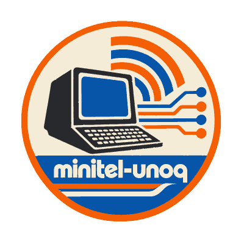
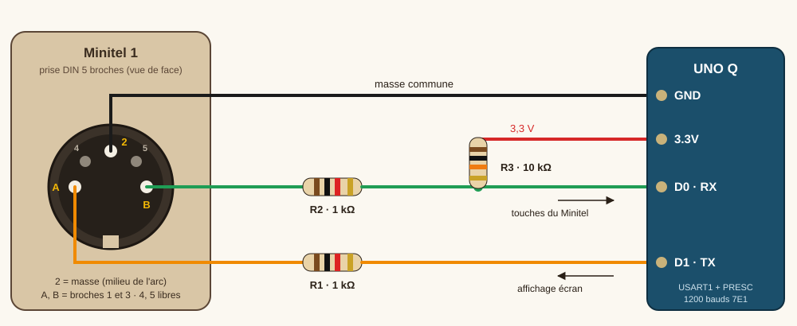

<p align="center">
  
</p>

<h1 align="center">minitel-unoq</h1>

<p align="center"><b>Un vrai Minitel de 1985 connecté à MiniPavi, sans ligne téléphonique, grâce à un Arduino UNO Q.</b></p>

L'UNO Q se branche sur la prise DIN « péri-informatique » du Minitel et sert de passerelle Wi-Fi vers [MiniPavi](https://www.minipavi.fr/) (`go.minipavi.fr:516`). Le Minitel croit parler au réseau Télétel ; en réalité c'est un petit Linux qui fait tout le travail. La matrice LED de la carte affiche l'état de la connexion.

Testé sur un **Minitel 1 Telic-Alcatel (marché PTT d'avril 1985)**, le modèle sans touche Fnct ni numéroteur. Les Minitel plus récents (1B, 2, 12…) devraient fonctionner aussi.

## Matériel

- un Minitel avec prise DIN 5 broches à l'arrière
- un Arduino UNO Q, déjà configuré avec App Lab et connecté au Wi-Fi
- 2 résistances de **1 kΩ** et 1 de **10 kΩ**
- une breadboard et quelques fils Dupont (ou mieux : une fiche DIN 5 broches mâle 180°)

## Câblage



| Prise DIN du Minitel | Composant | UNO Q |
|---|---|---|
| broche 2 (trou du milieu, masse) | direct | **GND** |
| broche 3 (sortie du Minitel) | 1 kΩ en série | **D0 / RX** + pull-up 10 kΩ vers **3.3V** |
| broche 1 (entrée du Minitel) | 1 kΩ en série | **D1 / TX** |
| broches 4 et 5 | — | non branchées |

- **3,3 V, pas 5 V** pour le pull-up.
- Selon le côté d'où l'on regarde la prise, l'ordre des broches 1 et 3 s'inverse. Pas de panique : les résistances de 1 kΩ rendent une inversion sans danger. Si rien ne s'affiche, échangez les deux fils des extrémités.
- Les broches Dupont (0,6 mm) flottent dans une prise DIN (1,5 mm) : pliez-les légèrement et calez-les.
- Codes couleur, résistances à 5 anneaux : 1 kΩ = marron noir noir marron, 10 kΩ = marron noir noir rouge. À 4 anneaux : marron noir rouge / marron noir orange.

## Installation

Il faut un accès SSH par clé à la carte (utilisateur `arduino`) :

```sh
ssh-copy-id arduino@uno-q.local
```

Puis, depuis ce dépôt, une seule commande :

```sh
./deploy.sh uno-q.local                                         # Linux / macOS
powershell -ExecutionPolicy Bypass -File deploy.ps1 -Hote uno-q.local   # Windows
```

Le script copie l'appli dans `~/ArduinoApps/minitel-unoq`, arrête l'appli en cours et démarre celle-ci (compilation du sketch sur la carte, environ 2 minutes la première fois). On peut aussi copier le dossier à la main et la lancer depuis App Lab.

## Utilisation

1. Allumez le Minitel. L'écran d'accueil **MINIPAVI** s'affiche en double hauteur.
2. Appuyez sur **Connexion/Fin** : la passerelle ouvre la connexion et le guide MiniPavi se dessine (à 1200 bauds, une page pleine prend quelques secondes, comme en 1985).
3. **Connexion/Fin** côté serveur pour raccrocher : retour à l'écran d'accueil.

La matrice LED en façade :

| Icône | État |
|---|---|
| `…` | démarrage |
| **M** | prêt, appuyez sur Connexion/Fin |
| `>>` | connexion en cours |
| ✓ (avec un point qui clignote à chaque échange) | en ligne |
| **X** | serveur injoignable |

## Comment ça marche

```
Minitel ──DIN 1200 bauds 7E1──► STM32 (sketch) ──Bridge RPC──► Linux (Python) ──Wi-Fi/TCP──► go.minipavi.fr:516
```

- **`sketch/sketch.ino`** (microcontrôleur STM32U585) : un tuyau transparent entre le Minitel et Linux sur l'USART1 réglée à 1200 bauds, plus la matrice LED.
- **`python/main.py`** (Linux) : l'écran d'accueil, la touche Connexion/Fin et la connexion TCP à MiniPavi.

### Les pièges rencontrés (et contournés)

**1. `Serial1.begin(1200)` n'a aucun effet.** Sur l'UNO Q, D0/D1 (PB7/PB6) correspondent à l'USART1, cadencée à 160 MHz. Pour 1200 bauds, le diviseur vaudrait 160 000 000 / 1200 = 133 333, or le registre `BRR` ne fait que 16 bits (65 535 max) : le pilote Zephyr refuse la configuration et l'USART reste à sa vitesse précédente (la console, 115 200 bauds). Symptôme : le Minitel n'affiche que des `?` en vidéo inversée et quelques lettres au hasard.

La solution : le STM32U5 a un **prédiviseur** (`USART_PRESC`) que le pilote n'utilise pas. Le sketch ouvre `Serial1` à 9600 bauds (que le pilote sait régler), puis arrête l'USART, écrit `PRESC = ÷8` et `BRR = 160 MHz / 8 / 1200 = 16 667`, et la relance : 1199,98 bauds. La fonction `minitel_diag` (Bridge) renvoie les registres pour vérifier.

> Une première version utilisait une **UART logicielle** (bits posés à la main en `micros()`, réception par interruption sur front). Elle fonctionne quand la carte ne fait rien d'autre, mais dès qu'un autre code charge les interruptions (par exemple la matrice LED en 256 niveaux de gris), les bits se décalent et des caractères parasites apparaissent. L'UART matérielle est insensible à tout ça.

**2. Le 7E1 géré à la main.** La trame matérielle est en 8N1 ; le code met la parité paire dans le bit 7 de chaque octet émis et la retire à la réception. Même trame de 10 bits que le 7E1 du Minitel, sans dépendre du support des formats 7 bits du cœur Arduino Zephyr.

**2 bis. Ne jamais bloquer la boucle.** Le Python dépose les octets dans une file du microcontrôleur (`minitel_write` renvoie combien ont été acceptés) ; `loop()` les donne à `Serial1` au rythme de 1200 bauds, par rafales de 8 au plus, pour que `write()` ne bloque jamais.

**3. Connexion/Fin n'a pas le même code partout.** Le Minitel 1 de 1985 envoie `SEP 0x59` au lieu du `SEP 0x49` des modèles plus récents. La passerelle accepte les deux et traduit `0x59` en `0x49` vers le serveur.

**4. Les aiguillages PRO3.** Au démarrage, la passerelle envoie au Minitel les commandes `ESC ; a/` (protocole péri-informatique de 1982) pour relier clavier → prise et prise → écran, et couper le modem. Même le modèle de 1985 les accepte et répond `ESC ; c …`.

**5. Une seule connexion à la fois.** Plusieurs appuis rapides sur Connexion/Fin lançaient des connexions concurrentes ; elles sont désormais ignorées tant qu'une connexion est en cours.

## Dépannage

| Symptôme | Cause probable | Action |
|---|---|---|
| Écran vide, matrice sur **M** | broches 1 et 3 inversées | échanger les deux fils des extrémités |
| `?` en vidéo inversée et lettres au hasard | mauvaise vitesse | vérifier les registres : `Bridge.call("minitel_diag")` doit donner `PRESC=4` et un BRR d'environ 16 667 |
| Accueil affiché, Connexion/Fin sans effet | retour Minitel → carte absent | vérifier le pull-up 10 kΩ et le fil de la broche 3 ; lire les logs |
| Caractères parasites au démarrage de la carte | journal de boot Zephyr sur D1 | normal, l'écran d'accueil les efface |
| Matrice sur **X** | MiniPavi injoignable | vérifier le Wi-Fi de la carte |

Logs :

```sh
ssh arduino@uno-q.local arduino-app-cli app logs user:minitel-unoq
```

## Idées pour la suite

- utiliser le Minitel comme écran et clavier de l'UNO Q pour d'autres applis (tableau de bord, compagnon IA, serveur local)
- choisir le service avec un téléphone à cadran rotatif branché sur un GPIO
- héberger son propre service en local avant de le publier sur MiniPavi

## Merci

À [MiniPavi](https://www.minipavi.fr/), qui fait revivre les services Minitel et accepte les connexions TCP directes.

## Licence

MIT, voir [LICENSE](LICENSE).
